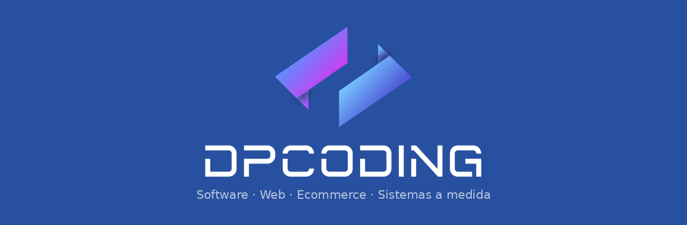

<!--
  Perfil público de la organización DP Coding.
  Este README se renderiza en https://github.com/DPCODING-SPA
-->

<p align="center">
  
</p>

<p align="center">
  <a href="https://www.dpcoding.cl"></a>
  <a href="mailto:contacto@dpcoding.cl"></a>
  
</p>

---

## Quiénes somos

**DP Coding** es una software house chilena. Diseñamos, construimos y operamos productos digitales para empresas que necesitan digitalizar, automatizar e integrar sus procesos — con foco en calidad de entrega y operación en producción.

Trabajamos con startups, PyMEs y organizaciones que requieren sitios, ecommerce y sistemas internos listos para el día a día.

## Qué entregamos

| Línea | Qué incluye |
| --- | --- |
| **Producto web** | Sitios corporativos, institucionales y landings de alto rendimiento |
| **Ecommerce** | Catálogo, checkout, pagos, inventario y panel de administración |
| **Sistemas a medida** | Cotizadores, reservas, finanzas, tickets, leads y paneles operativos |
| **Operación** | Deploy, monitoreo, backups y mantención en VPS / cloud |

## Stack

```text
Frontend   TypeScript · React · Next.js · Vite · Tailwind
Backend    PHP · Laravel · Node · Python
Datos      MySQL · APIs REST
Ops        Docker · Nginx · CI/CD · VPS
```

## Portafolio seleccionado

Proyectos en producción (código cliente privado por confidencialidad):

| Proyecto | Tipo | URL |
| --- | --- | --- |
| **DP Coding** | Sitio institucional | [dpcoding.cl](https://www.dpcoding.cl) |
| **Re-uso** | Ecommerce | [reuso.cl](https://reuso.cl) |
| **Ganbaru Clothing** | Ecommerce / drops | [ganbaruclothing.cl](https://ganbaruclothing.cl) |
| **Techocaron** | Web + cotizador | [techocaron.cl](https://techocaron.cl) |
| **Centro Cristiano Plenitud** | Sitio institucional | [ccplenitud.cl](https://ccplenitud.cl) |
| **ECHH** | Sitio corporativo | [echh.cl](https://echh.cl) |
| **Domotex Spa** | Ecommerce | [domotexspa.cl](https://domotexspa.cl) |
| **Español Osorno** | Sitio + abonados | Club Deportivo Español |
| **TuCabaña / Reservas** | Sistema de reservas | Interno / cliente |
| **Mesa de Ayuda · Finanzas · Leads** | Suites internas DP | Operación DP Coding |

## Cómo trabajamos

1. **Descubrimiento** — objetivo de negocio, alcance y prioridades  
2. **Diseño & arquitectura** — UX, modelo de datos e integraciones  
3. **Construcción** — sprints con demos y ambientes de staging  
4. **Go-live & operación** — deploy, monitoreo y mejora continua  

## Contacto comercial

| | |
| --- | --- |
| **Web** | [www.dpcoding.cl](https://www.dpcoding.cl) |
| **Email** | [contacto@dpcoding.cl](mailto:contacto@dpcoding.cl) |
| **Ubicación** | Osorno, Chile · atención a todo el país |

---

<p align="center">
  
  <br />
  <sub><b>DP Coding</b> · Construimos software que las empresas realmente usan.</sub>
</p>
